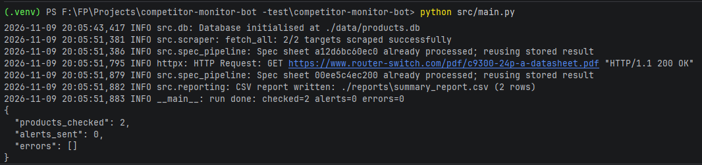
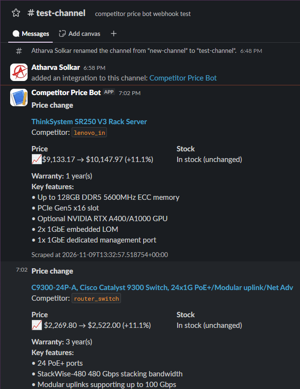

# Competitor Price & Tech Monitor Bot

A daily background job. It scrapes competitor product pages (price, stock, spec-sheet PDF),
extracts warranty / power / key features from new PDFs with an LLM, compares against the last
snapshot, posts a Slack alert on a meaningful change, and writes `reports/summary_report.csv`.
No web server, no API routes.

Competitor Price & Tech Monitor Bot is a daily background job that watches competitor product pages and alerts you on Slack when something meaningful changes.
What it does:

Scrapes each competitor product page for price, stock status and the spec-sheet PDF.
Reads new spec PDFs with an LLM  and pulls out warranty, power consumption and key features.
Compares today’s data with the last saved snapshot.
Sends a Slack alert if the price moves 5% or more, or the stock status changes.
Saves history to SQLite and writes a summary CSV (reports/summary_report.csv).

## Screenshots

# Terminal Output:


# Slack Message Recived after a price change:


## Setup

```bash
python3.11 -m venv .venv && source .venv/bin/activate
pip install -r requirements.txt
playwright install chromium
cp .env.example .env        # then fill in the values below
```

Edit `.env`:

| Variable | Meaning |
|---|---|
| `ANTHROPIC_API_KEY` | Claude API key (spec-sheet extraction) |
| `AI_MODEL` | Claude model ID (default `claude-sonnet-4-5`; check it is valid for your account) |
| `SLACK_WEBHOOK_URL` | Slack Incoming Webhook for alerts and "run failed" messages |
| `PRICE_CHANGE_THRESHOLD_PCT` | Alert when price moves by at least this percent (default 5.0) |

Everything else has a working default (see `.env.example`).

## Targets

`config/targets.json` lists the products to watch:

```json
[{"site_id": "router_switch", "product_url": "https://...", "requires_js": true}]
```

Each `site_id` must have an entry in `src/site_parsers.py` (CSS selectors). A new competitor =
one `targets.json` line + one `site_parsers.py` entry.

## Run manually

From the repo root:

```bash
python src/main.py          # or: python -m src.main
```

Prints a JSON summary (`products_checked`, `alerts_sent`, `errors`). Exit code is 1 only if the
whole run failed; per-product problems are listed in `errors` and in the CSV.

First run for a product only stores a baseline (no alert). Running twice in one day does not
re-alert: each run compares against the snapshot the previous run saved.

Outputs: `data/products.db`, `reports/summary_report.csv`, `logs/run.log`.

## Schedule it

Simplest (OS cron, daily 06:00 server time; adjust paths):

```cron
0 6 * * * cd /path/to/competitor-monitor-bot && .venv/bin/python src/main.py >> logs/cron.out 2>&1
```

Alternative (long-running process, daily at `RUN_HOUR_UTC`; needs `pip install apscheduler`):

```bash
python src/scheduler.py
```

## Troubleshooting

Operations guide (key rotation, threshold, adding a competitor, reading the log): see `HANDOFF.md`.

- Read `logs/run.log`. Look for `Claude API call failed` (bad key or model ID), `Slack`
  non-200 lines, and `scrape failed` entries.
- A product whose scrape failed shows `scrape_success = 0` and an `error_message` in the CSV.
- A failed Slack send is not retried on the next run (the new price is already saved as the baseline).
- If a site returns HTTP 403 it is blocking the bot; the bot logs it and does not try to evade.

## Maintenance note

Selectors in `src/site_parsers.py` break if a competitor redesigns its page. Both current
targets also publish schema.org JSON-LD, which is tried first and is more stable.

## Tests

```bash
python -m pytest -q
```
